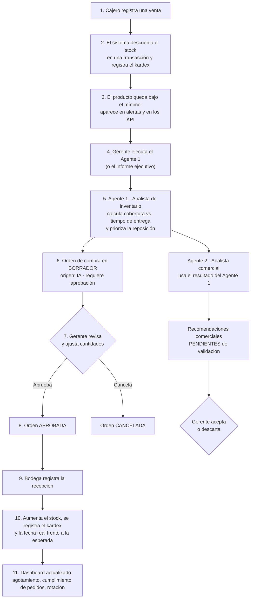
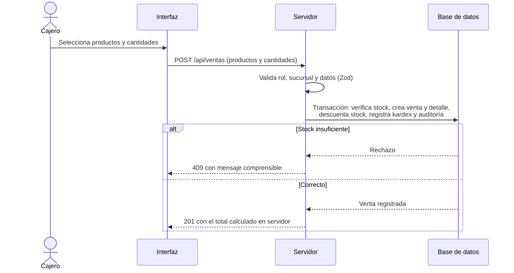
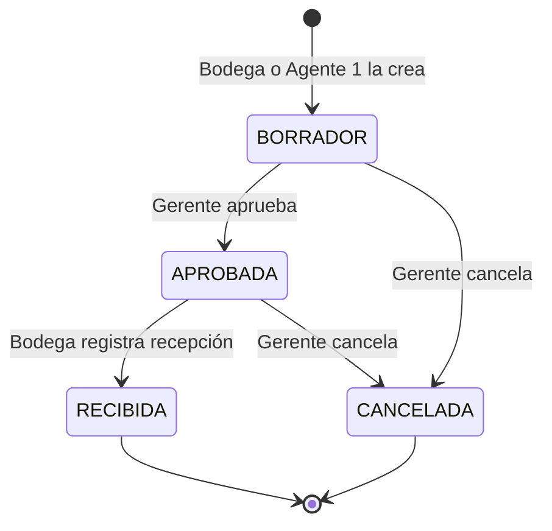

# 03-NEG — Negocio, sistema y flujos

---

## 1. La organización

**Supermercados Ceiba S.A.S.** es una cadena de supermercados **ficticia**, con sede administrativa en Medellín y cuatro sucursales en el Valle de Aburrá:

| Código | Sucursal | Perfil |
|---|---|---|
| SUC-CEN | Ceiba Centro | Alto flujo de clientes, ticket bajo |
| SUC-LAU | Ceiba Laureles | Clientes recurrentes, ticket alto |
| SUC-ENV | Ceiba Envigado | Mayor volumen de ventas |
| SUC-BEL | Ceiba Bello | Sucursal reciente, ventas por debajo de la meta |

Comercializa productos de consumo masivo agrupados en categorías como abarrotes, lácteos, bebidas, aseo, frutas y verduras, panadería, carnes y cuidado personal. Se abastece de varios proveedores, cada uno con un tiempo de entrega pactado.

Todos los datos de la organización, sus clientes, proveedores y transacciones son **ficticios** y se generan con el script de datos de demostración.

---

## 2. Problema empresarial

La dirección de Supermercados Ceiba enfrenta los siguientes problemas, tomados del escenario A de la guía:

1. **Agotamiento de productos de alta demanda.** Los productos más vendidos se acaban antes de que llegue el pedido, porque la reposición se decide por intuición y sin considerar el tiempo de entrega del proveedor.
2. **Exceso de inventario y baja rotación.** Otros productos permanecen semanas en bodega, inmovilizando capital.
3. **Retrasos en el abastecimiento.** No se mide si los proveedores entregan a tiempo.
4. **Falta de información consolidada.** Las ventas, márgenes y existencias de cada sucursal se revisan por separado, sin una visión gerencial común.
5. **Dificultad para identificar clientes frecuentes.**
6. **Demoras para responder preguntas de empleados y directivos** sobre el estado del negocio.

---

## 3. La solución: CeibaERP

CeibaERP es un sistema de planificación de recursos empresariales que **integra en una sola base de datos** las ventas, el inventario por sucursal, las compras a proveedores y los catálogos del negocio. Sobre esos datos ofrece:

- **Un dashboard gerencial** con indicadores calculados en tiempo real.
- **Un chatbot** que responde preguntas en lenguaje natural consultando los datos reales del sistema.
- **Dos agentes de IA** que analizan el inventario y el comportamiento comercial, proponen acciones y colaboran entre sí. Sus propuestas **siempre requieren validación humana**.

### 3.1 Justificación de un ERP (y no de un CRM)

Los problemas identificados nacen en los **procesos internos de operación** (abastecimiento, inventario, ventas y relación con proveedores) y en la falta de integración de sus datos. Eso es precisamente el ámbito de un ERP: integrar procesos empresariales como ventas, inventarios, compras y gestión financiera. Un CRM se centra en la relación con el cliente (oportunidades comerciales, fidelización, atención) y no resolvería el agotamiento, la baja rotación ni los retrasos de proveedores.

La identificación de clientes frecuentes (problema 5) se cubre como un indicador del ERP a partir de las ventas, sin requerir un módulo CRM completo.

---

## 4. Roles

| Rol | Descripción | Alcance de datos |
|---|---|---|
| **Administrador** | Gestiona usuarios y catálogos maestros; consulta la auditoría | Todas las sucursales |
| **Gerente** | Consulta el dashboard y los reportes, ejecuta los agentes, aprueba o cancela órdenes de compra, valida recomendaciones y anula ventas | Todas las sucursales |
| **Bodega** | Jefe de bodega de una sucursal: consulta y ajusta inventario, crea órdenes de compra en borrador y registra la recepción de mercancía | Su sucursal |
| **Cajero** | Registra ventas y clientes en su sucursal | Su sucursal |

### 4.1 Matriz de permisos

| Funcionalidad | Administrador | Gerente | Bodega | Cajero |
|---|:-:|:-:|:-:|:-:|
| Usuarios | CRUD | — | — | — |
| Sucursales, categorías, proveedores | CRUD | Consultar | Consultar | — |
| Productos | CRUD | Consultar | Consultar | Consultar |
| Clientes | CRUD | Consultar | — | Crear y consultar |
| Inventario | Consultar | Consultar | Consultar y ajustar (su sucursal) | Consultar (su sucursal) |
| Ventas | Consultar | Consultar y anular | — | Registrar y consultar (su sucursal) |
| Órdenes de compra | Consultar | Aprobar y cancelar | Crear borrador y recibir (su sucursal) | — |
| Dashboard y reportes | Sí | Sí | Inventario de su sucursal | — |
| Agentes de IA | Ejecutar | Ejecutar y validar recomendaciones | — | — |
| Chatbot | Sí | Sí | Sí (su sucursal) | Sí (su sucursal) |
| Auditoría | Consultar | — | — | — |

Los permisos se verifican **en el servidor** en cada operación, no solo ocultando opciones en la interfaz.

---

## 5. Módulos

| Módulo | Responsabilidad |
|---|---|
| **Autenticación y usuarios** | Inicio de sesión, roles, asignación de sucursal |
| **Catálogos** | Productos, categorías, proveedores, sucursales y clientes |
| **Inventario** | Existencias por producto y sucursal, stock mínimo y máximo, ajustes con motivo, kardex de movimientos |
| **Ventas** | Registro de ventas en caja con varios ítems y anulación con restitución de stock |
| **Compras** | Órdenes de compra a proveedores, aprobación, recepción y cumplimiento de entregas |
| **Dashboard** | KPI, gráficos, filtros, interpretación de resultados |
| **Reportes** | Consulta y exportación de reportes en CSV |
| **Chatbot** | Preguntas en lenguaje natural sobre los datos del sistema |
| **Agentes** | Analista de inventario, analista comercial e informe ejecutivo que los coordina |
| **Auditoría** | Registro de las operaciones principales y de las ejecuciones de IA |

---

## 6. Flujo de negocio principal: ciclo de abastecimiento inteligente

Es el proceso de extremo a extremo que integra la gestión de datos, la lógica de negocio, la IA y el dashboard.

**Pasos clave:**

1. El cajero registra una venta con varios productos; los precios y costos se toman del servidor, no del cliente.
2. El sistema valida que haya existencias suficientes y descuenta el stock en una transacción atómica; registra el movimiento en el kardex.
3. Cuando un producto queda en o por debajo de su stock mínimo, aparece en las alertas del dashboard y afecta los KPI de agotamiento.
4. El gerente ejecuta el agente de inventario, o el informe ejecutivo que coordina ambos agentes.
5. El **Agente 1** consulta las existencias, el promedio de ventas diarias y el tiempo de entrega de cada proveedor; calcula los días de cobertura, prioriza los productos en riesgo y explica sus criterios.
6. Por cada proveedor involucrado se crea una orden de compra en **BORRADOR**, marcada como generada por IA.
7. El gerente revisa la propuesta, puede ajustar cantidades y decide.
8. La orden pasa a **APROBADA** o **CANCELADA**.
9. El jefe de bodega registra la recepción de la mercancía.
10. El stock aumenta, se registra el movimiento y la fecha real de entrega frente a la esperada.
11. El dashboard refleja el cambio en agotamiento, cumplimiento de pedidos y rotación.

En paralelo, el **Agente 2** analiza ventas por producto y sucursal, tendencias y baja rotación, **tomando en cuenta el resultado del Agente 1**. Por ejemplo, no recomienda promocionar un producto en riesgo de agotamiento, pero sí liquidar uno con exceso de inventario. Sus recomendaciones quedan **PENDIENTES** hasta que el gerente las acepte o descarte.

---

## 7. Flujos secundarios

### 7.1 Venta en caja

### 7.2 Ajuste de inventario

El jefe de bodega corrige existencias (mermas, conteo físico) indicando cantidad y **motivo obligatorio**. El ajuste queda en el kardex y en la auditoría. No se permite dejar el stock negativo.

### 7.3 Anulación de venta

El gerente anula una venta registrada indicando el motivo. El stock de cada producto se restituye y se registra en el kardex. Una venta anulada no se cuenta en los KPI.

---

## 8. Estados

### 8.1 Orden de compra

Cualquier otra transición se rechaza en el servidor.

### 8.2 Venta

`REGISTRADA → ANULADA`, solo por el gerente.

### 8.3 Recomendación de un agente

`PENDIENTE → ACEPTADA | DESCARTADA`, solo por el gerente, con registro de quién decidió y cuándo.

---

## 9. Alcance

### 9.1 Dentro del alcance

Todo lo exigido por la guía: gestión de datos con CRUD, persistencia, el flujo de negocio completo descrito, IA aplicada a la reposición y al análisis comercial, chatbot con datos reales, dos agentes con interacción definida, dashboard con al menos seis KPI, reportes exportables, validaciones, manejo de errores, pruebas, repositorio documentado, capturas e informe.

### 9.2 Fuera del alcance

- Pasarelas de pago (PayPal, bancos) y procesamiento real de pagos. La venta registra el **medio de pago** solo como dato.
- Facturación electrónica ante la DIAN, contabilidad completa y nómina.
- Recepciones parciales de órdenes de compra y devoluciones parciales de clientes.
- Transferencias de inventario entre sucursales.
- Aplicación móvil nativa.
- Decisiones automáticas de la IA sin aprobación humana.

---

## 10. Supuestos

- Moneda única: peso colombiano (COP), sin impuestos discriminados.
- Cada producto tiene un proveedor principal con un tiempo de entrega en días.
- Cada usuario de los roles Bodega y Cajero pertenece a una sola sucursal.
- Los datos de demostración cubren aproximadamente 90 días de operación e incluyen, a propósito, productos en riesgo de agotamiento, productos de baja rotación, una sucursal con bajo desempeño y un proveedor con entregas tardías, para que los KPI y los agentes produzcan resultados verificables.
