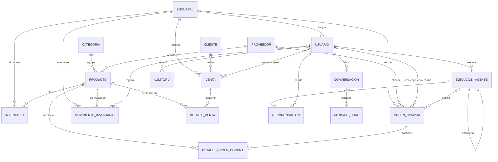

# 05-DAT — Modelo de datos

Motor: **PostgreSQL** (Supabase) · ORM: **Prisma** · Esquema: `public` · Identificadores: enteros autoincrementales · Montos: `DECIMAL(14,2)` en pesos colombianos.

**Nombres:** en el código (Prisma/TypeScript) los modelos y campos usan los nombres de este documento (`DetalleVenta.precioUnitario`). En la base de datos, tablas y columnas se nombran en *snake_case* mediante `@@map` y `@map` (`detalle_venta.precio_unitario`), para facilitar las consultas SQL de verificación.

---

## 1. Diagrama entidad-relación

---

## 2. Enumeraciones

| Enumeración | Valores |
|---|---|
| `Rol` | `ADMIN`, `GERENTE`, `BODEGA`, `CAJERO` |
| `MedioPago` | `EFECTIVO`, `TARJETA_DEBITO`, `TARJETA_CREDITO`, `TRANSFERENCIA` |
| `EstadoVenta` | `REGISTRADA`, `ANULADA` |
| `EstadoOrdenCompra` | `BORRADOR`, `APROBADA`, `RECIBIDA`, `CANCELADA` |
| `OrigenOrdenCompra` | `MANUAL`, `AGENTE_INVENTARIO` |
| `TipoMovimiento` | `CARGA_INICIAL`, `VENTA`, `ANULACION_VENTA`, `RECEPCION_COMPRA`, `AJUSTE_ENTRADA`, `AJUSTE_SALIDA` |
| `TipoAgente` | `INVENTARIO`, `COMERCIAL`, `INFORME_EJECUTIVO` |
| `EstadoEjecucion` | `EN_CURSO`, `COMPLETADA`, `FALLIDA` |
| `TipoRecomendacion` | `REPOSICION`, `PROMOCION`, `LIQUIDACION`, `REVISION_SUCURSAL`, `OTRA` |
| `Prioridad` | `ALTA`, `MEDIA`, `BAJA` |
| `EstadoRecomendacion` | `PENDIENTE`, `ACEPTADA`, `DESCARTADA` |
| `RolMensaje` | `USUARIO`, `ASISTENTE` |

---

## 3. Diccionario de datos

Todas las tablas incluyen `id` (PK, entero autoincremental). Las marcadas con † incluyen además `createdAt` y `updatedAt`.

### 3.1 Organización y usuarios

**Sucursal †**

| Campo | Tipo | Restricciones | Descripción |
|---|---|---|---|
| codigo | varchar(10) | único, no nulo | Ej. `SUC-ENV` |
| nombre | varchar(80) | no nulo | Ej. Ceiba Envigado |
| ciudad | varchar(60) | no nulo | |
| direccion | varchar(120) | no nulo | |
| activa | boolean | por defecto `true` | |

**Usuario †**

| Campo | Tipo | Restricciones | Descripción |
|---|---|---|---|
| nombre | varchar(100) | no nulo | |
| email | varchar(120) | único, no nulo | En minúsculas |
| passwordHash | varchar(100) | no nulo | bcrypt; nunca se expone en la API |
| rol | `Rol` | no nulo | |
| sucursalId | int | FK → Sucursal, nulo para ADMIN y GERENTE | RN-20 |
| activo | boolean | por defecto `true` | |
| ultimoAcceso | timestamptz | nulo | |

### 3.2 Catálogos

**Categoria †**: `nombre` varchar(60) único · `descripcion` varchar(200) nulo · `activa` boolean.

**Proveedor †**

| Campo | Tipo | Restricciones |
|---|---|---|
| nit | varchar(20) | único, no nulo |
| nombre | varchar(120) | no nulo |
| contacto | varchar(100) | nulo |
| telefono | varchar(30) | nulo |
| email | varchar(120) | nulo |
| tiempoEntregaDias | int | no nulo, > 0 |
| activo | boolean | por defecto `true` |

**Producto †**

| Campo | Tipo | Restricciones |
|---|---|---|
| sku | varchar(20) | único, no nulo |
| nombre | varchar(120) | no nulo |
| descripcion | varchar(300) | nulo |
| categoriaId | int | FK → Categoria |
| proveedorId | int | FK → Proveedor (proveedor principal) |
| unidad | varchar(20) | no nulo (unidad, kg, paquete…) |
| costo | decimal(14,2) | > 0 |
| precio | decimal(14,2) | ≥ costo (RN-14) |
| activo | boolean | por defecto `true` |

**Cliente †**: `documento` varchar(20) único · `nombre` varchar(120) · `email` varchar(120) nulo · `telefono` varchar(30) nulo · `activo` boolean.

### 3.3 Inventario

**Inventario**

| Campo | Tipo | Restricciones |
|---|---|---|
| productoId | int | FK → Producto |
| sucursalId | int | FK → Sucursal |
| stock | int | ≥ 0 (RN-01) |
| stockMinimo | int | ≥ 0 |
| stockMaximo | int | > stockMinimo (RN-13) |
| updatedAt | timestamptz | |

Llave única compuesta: (`productoId`, `sucursalId`).

**MovimientoInventario** (kardex)

| Campo | Tipo | Descripción |
|---|---|---|
| productoId | int | FK → Producto |
| sucursalId | int | FK → Sucursal |
| tipo | `TipoMovimiento` | |
| cantidad | int | Con signo: positiva entra, negativa sale |
| stockResultante | int | Stock después del movimiento |
| referenciaTipo | varchar(30) | `VENTA`, `ORDEN_COMPRA`, `AJUSTE`, nulo |
| referenciaId | int | Id del documento origen, nulo |
| motivo | varchar(200) | Obligatorio en ajustes |
| usuarioId | int | FK → Usuario, nulo en la carga inicial |
| fecha | timestamptz | Índice (`productoId`, `sucursalId`, `fecha`) |

### 3.4 Ventas

**Venta**

| Campo | Tipo | Descripción |
|---|---|---|
| sucursalId | int | FK → Sucursal |
| cajeroId | int | FK → Usuario |
| clienteId | int | FK → Cliente, nulo (venta sin identificar) |
| fecha | timestamptz | Índice (`sucursalId`, `fecha`) |
| medioPago | `MedioPago` | |
| estado | `EstadoVenta` | Por defecto `REGISTRADA` |
| total | decimal(14,2) | Σ subtotales, calculado en servidor |
| costoTotal | decimal(14,2) | Σ cantidad × costo unitario, para el margen |
| anuladaPorId | int | FK → Usuario, nulo |
| fechaAnulacion | timestamptz | nulo |
| motivoAnulacion | varchar(200) | nulo |

**DetalleVenta**: `ventaId` FK · `productoId` FK · `cantidad` int > 0 · `precioUnitario` decimal · `costoUnitario` decimal · `subtotal` decimal. Precio y costo son una copia del producto al momento de la venta (RN-02).

### 3.5 Compras

**OrdenCompra †**

| Campo | Tipo | Descripción |
|---|---|---|
| proveedorId | int | FK → Proveedor |
| sucursalId | int | FK → Sucursal destino |
| estado | `EstadoOrdenCompra` | Por defecto `BORRADOR` |
| origen | `OrigenOrdenCompra` | `MANUAL` o `AGENTE_INVENTARIO` |
| ejecucionAgenteId | int | FK → EjecucionAgente, nulo |
| creadaPorId | int | FK → Usuario (quien ejecutó el agente, si el origen es IA) |
| aprobadaPorId | int | FK → Usuario, nulo |
| recibidaPorId | int | FK → Usuario, nulo |
| fechaAprobacion | timestamptz | nulo |
| fechaEsperada | date | no nulo |
| fechaRecepcion | date | nulo |
| motivoCancelacion | varchar(200) | nulo |
| total | decimal(14,2) | Σ subtotales |
| observaciones | varchar(500) | nulo; justificación del agente cuando aplica |

**DetalleOrdenCompra**: `ordenCompraId` FK · `productoId` FK · `cantidad` int > 0 · `costoUnitario` decimal · `subtotal` decimal.

### 3.6 Inteligencia artificial

**EjecucionAgente**

| Campo | Tipo | Descripción |
|---|---|---|
| agente | `TipoAgente` | |
| estado | `EstadoEjecucion` | |
| parametros | jsonb | Entrada (sucursal, periodo…) |
| herramientasUsadas | jsonb | Lista de llamadas: herramienta, argumentos y resumen del resultado |
| resultado | jsonb | Salida estructurada validada con Zod |
| resumen | text | Texto para mostrar al usuario |
| modelo | varchar(60) | Modelo de Gemini usado |
| duracionMs | int | |
| error | text | nulo |
| ejecutadoPorId | int | FK → Usuario |
| ejecucionPadreId | int | FK → EjecucionAgente; liga los agentes al informe ejecutivo |
| ejecucionEntradaId | int | FK → EjecucionAgente; la ejecución del Agente 1 que consumió el Agente 2 |
| fechaInicio | timestamptz | |
| fechaFin | timestamptz | nulo |

**Recomendacion**

| Campo | Tipo | Descripción |
|---|---|---|
| ejecucionId | int | FK → EjecucionAgente |
| tipo | `TipoRecomendacion` | |
| prioridad | `Prioridad` | |
| productoId | int | FK → Producto, nulo |
| sucursalId | int | FK → Sucursal, nulo |
| titulo | varchar(150) | |
| justificacion | text | Datos que la sustentan |
| estado | `EstadoRecomendacion` | Por defecto `PENDIENTE` |
| decididaPorId | int | FK → Usuario, nulo |
| fechaDecision | timestamptz | nulo |
| comentarioDecision | varchar(300) | nulo |
| createdAt | timestamptz | |

**Conversacion**: `usuarioId` FK · `titulo` varchar(120) · `createdAt`.

**MensajeChat**: `conversacionId` FK · `rol` `RolMensaje` · `contenido` text · `herramientasUsadas` jsonb nulo · `modelo` varchar(60) nulo · `createdAt`.

### 3.7 Auditoría

**Auditoria**: `usuarioId` FK nulo · `accion` varchar(40) (ej. `VENTA_REGISTRADA`, `LOGIN_FALLIDO`) · `entidad` varchar(40) · `entidadId` int nulo · `detalle` jsonb nulo · `ip` varchar(45) nulo · `fecha` timestamptz con índice.

---

## 4. Integridad en la base de datos

- Llaves foráneas con `ON DELETE RESTRICT` en las entidades con historial (RN-16).
- Restricciones `CHECK` adicionales en la migración: `stock >= 0`, `cantidad > 0` en los detalles, `costo > 0`, `precio >= costo` y `stockMaximo > stockMinimo`. Son la última línea de defensa si falla la validación de la aplicación.
- La venta, la anulación, la recepción y los ajustes usan transacciones con bloqueo de fila sobre `Inventario` (`SELECT … FOR UPDATE` o actualización condicional `stock = stock - n WHERE stock >= n`) para evitar condiciones de carrera.

---

## 5. Datos de demostración (*seed*)

El script `prisma/seed.ts` (catálogos en `prisma/seed-datos.ts`) usa una semilla aleatoria fija: siempre produce los mismos datos, con las fechas relativas al día de ejecución (zona `America/Bogota`). Simula la operación **en orden cronológico**: recepciones de mercancía a las 07:30, ventas durante el día y reposición automática a las 18:00 para los productos en o bajo el mínimo. Así, el stock final, el kardex, las ventas y las órdenes son coherentes entre sí.

**Ejecución:** `npm run db:seed` carga la BD de demostración (`DATABASE_URL`). Con `SEED_DESTINO=test` carga el esquema de pruebas (`DATABASE_URL_TEST`). **Borra todos los datos del esquema de destino antes de cargar.** Usa el rol `ceiba_app`; los identificadores de ventas y órdenes se reservan con `nextval`, sin privilegios adicionales.

| Elemento | Cantidad (ejecución de referencia) |
|---|---|
| Sucursales | 4 |
| Usuarios de demostración | 10: 1 ADMIN, 1 GERENTE, 4 BODEGA y 4 CAJERO (uno de cada uno por sucursal), con correos `@ceiba.test` |
| Categorías | 8 |
| Proveedores | 8, con tiempos de entrega de 2 a 6 días |
| Productos | 60 |
| Clientes ficticios | 800 |
| Ventas | ≈ 10 000 en 90 días (≈ 80 anuladas), entre 15 y 50 diarias por sucursal |
| Órdenes de compra | ≈ 880: recibidas, aprobadas en tránsito, 2 en borrador y 2 canceladas |
| Movimientos de kardex | ≈ 26 000 |

**Casos sembrados a propósito**, para que los KPI y los agentes tengan hallazgos verificables:

1. **Riesgo de agotamiento:** 5 productos de alta demanda (arroz, aceite de girasol, café, leche y huevos) sin reposición en los últimos 12 días. Terminan con una cobertura cercana a la mitad del tiempo de entrega, ajustada con un conteo físico registrado en el kardex.
2. **Agotados:** combinaciones con stock 0. Tres son sembradas (frijol en Envigado, suavizante en Laureles y salchicha en Bello, sin reposición en los últimos 30 días); además puede agotarse algún producto del proveedor impuntual.
3. **Baja rotación y sobrestock:** 6 productos de muy baja demanda (quinua, aceite de oliva, vinagre balsámico, ambientador premium, champú anticaspa premium y crema facial) con existencias muy por encima del máximo.
4. **Sucursal de bajo desempeño:** Ceiba Bello vende cerca de la mitad del promedio de las demás.
5. **Proveedor impuntual:** Distribuidora Andina de Alimentos entrega a tiempo cerca del 55 % de sus pedidos, frente a 88–98 % de los demás.
6. **Tendencias:** más ventas en fines de semana y crecimiento de la categoría Bebidas (hasta +60 %) en las últimas 5 semanas.
7. **Clientes recurrentes:** entre el 30 % y el 55 % de las ventas tienen cliente identificado, según la sucursal; cerca de la mitad de los clientes activos en un mes compra más de una vez.
8. **Órdenes en todos los estados**, incluidas algunas aprobadas con la fecha esperada vencida y sin recibir.

**Contraseñas de demostración:** el *seed* las toma de la variable de entorno `SEED_DEMO_PASSWORD` (al menos 10 caracteres, con letras y números). No quedan escritas en el repositorio y se entregan solo en el informe.
