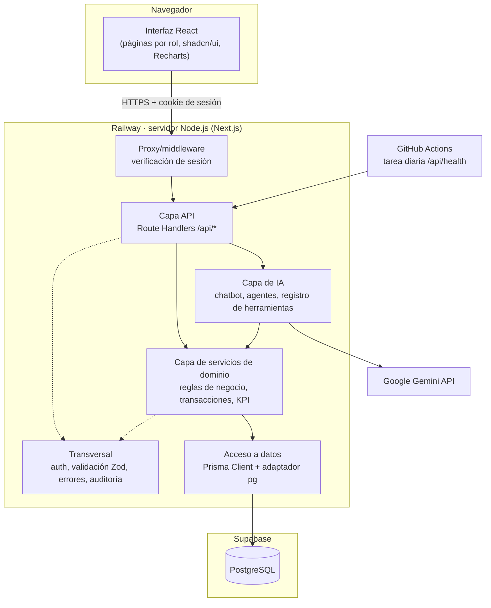

# 08-ARQ — Arquitectura y tecnologías

---

## 1. Vista general

CeibaERP es una **aplicación web monolítica modular** construida con Next.js. Interfaz y API viven en un mismo proyecto, pero el código se separa en capas con responsabilidades claras.



### 1.1 Capas

| Capa | Responsabilidad | No debe |
|---|---|---|
| **Presentación** (`src/app`, `src/components`) | Páginas, formularios, tablas, gráficos y chat | Contener reglas de negocio ni acceder a la BD |
| **API** (`src/app/api`) | Recibir peticiones, autenticar, autorizar, validar con Zod, llamar servicios y dar formato a respuestas y errores | Contener lógica de negocio |
| **Servicios de dominio** (`src/server/servicios`) | Reglas de negocio (RN), transacciones, cálculos de KPI, auditoría | Conocer HTTP |
| **IA** (`src/server/ia`) | Cliente de Gemini, herramientas, chatbot, agentes y orquestador | Acceder a la BD sin pasar por los servicios |
| **Acceso a datos** (`src/server/db.ts`, `prisma/`) | Esquema, migraciones, cliente Prisma | — |
| **Transversal** (`src/server/auth`, `src/server/validacion`, `src/server/errores.ts`) | Sesión, permisos, esquemas, errores tipados | — |

Regla de dependencias: Presentación → API → Servicios / IA → Acceso a datos. La IA usa los mismos servicios que el dashboard.

---

## 2. Estructura de carpetas

```text
tf-fsi-ceiba-erp/
├── docs/                          Documentación (este conjunto)
├── prisma/
│   ├── schema.prisma              Modelo de datos (05-DAT)
│   ├── migrations/                Migraciones SQL versionadas (incluye CHECK)
│   └── seed.ts                    Datos de demostración (05-DAT §5)
├── prisma.config.ts               Configuración de Prisma CLI (usa DIRECT_URL)
├── src/
│   ├── app/
│   │   ├── login/                 Inicio de sesión
│   │   ├── (app)/                 Rutas protegidas con el layout principal
│   │   │   ├── dashboard/
│   │   │   ├── catalogos/         productos, categorías, proveedores, sucursales, clientes
│   │   │   ├── usuarios/
│   │   │   ├── inventario/        existencias, ajustes, kardex
│   │   │   ├── ventas/            caja y consulta
│   │   │   ├── compras/           órdenes de compra
│   │   │   ├── reportes/
│   │   │   ├── chat/
│   │   │   ├── agentes/           ejecuciones y recomendaciones
│   │   │   └── auditoria/
│   │   └── api/                   Route Handlers (04-REQ §4)
│   ├── components/
│   │   ├── ui/                    Componentes shadcn/ui
│   │   └── ...                    Componentes por módulo
│   ├── lib/                       Utilidades de cliente (formato COP, fechas)
│   └── server/
│       ├── db.ts                  Instancia única de Prisma Client
│       ├── auth/                  Sesión JWT, contraseñas, permisos por rol y sucursal
│       ├── validacion/            Esquemas Zod por recurso
│       ├── servicios/             catalogos, inventario, ventas, compras, kpi, reportes, auditoria
│       ├── ia/
│       │   ├── gemini.ts          Cliente y bucle de llamadas a funciones
│       │   ├── herramientas/      Una herramienta por archivo (07-IAG §3)
│       │   ├── chatbot.ts
│       │   └── agentes/           inventario.ts, comercial.ts, informe-ejecutivo.ts
│       └── errores.ts             Errores de dominio → códigos HTTP
├── tests/
│   ├── unit/                      Vitest sin BD
│   ├── integracion/               Vitest contra la BD de pruebas
│   └── seguridad/                 Scripts PowerShell (10-PRU §4)
├── .env.example
├── README.md
└── package.json
```

---

## 3. Tecnologías y justificación

Versiones estables vigentes al 21/11/2026. Se fijan en `package.json` durante la Fase 2.

| Ámbito | Tecnología | Versión | Justificación |
|---|---|---|---|
| Entorno | Node.js | 24 LTS | Ya instalado; compatible con Next.js 16 (requiere ≥ 20.9) |
| Framework | Next.js (App Router) | 16.4 | Interfaz y API en un solo proyecto; renderizado en servidor; experiencia previa en el curso |
| UI | React | 19 | Incluido con Next.js |
| Lenguaje | TypeScript | la que fije `create-next-app` | Tipado estático y modelos generados por Prisma: menos errores en las reglas de negocio |
| Estilos y componentes | Tailwind CSS 4 + shadcn/ui | 4.3 | Componentes accesibles y consistentes (usabilidad, RNF-01) sin diseñar desde cero |
| Gráficos | Recharts | 3.x | Integración nativa con React; cubre líneas, barras y apiladas (G-01 a G-04) |
| Validación | Zod | 4.x | Un mismo esquema valida en cliente, en servidor y la salida de los agentes |
| Base de datos | PostgreSQL (Supabase) | 17 | Modelo relacional con transacciones y restricciones: integridad del inventario y KPI con SQL verificable; alojamiento gestionado gratuito |
| ORM | Prisma ORM + `@prisma/adapter-pg` | 7.10 (estable) | Esquema declarativo, migraciones versionadas, tipos generados. Se fija la 7.10 porque la etiqueta `latest` de npm apunta a una versión candidata 8.0 |
| IA | Google Gemini · `@google/genai` | 3.x | Llamadas a funciones y salidas JSON con esquema; nivel gratuito suficiente para el prototipo |
| Autenticación | `jose` (JWT) + `bcryptjs` | 6.x / 3.x | JWT firmado en cookie httpOnly, compatible con el proxy de Next.js; contraseñas con hash bcrypt |
| Pruebas | Vitest | 5.x | Rápido, compatible con TypeScript sin configuración extra |
| Pruebas E2E asistidas | TestSprite | Servicio | Generación y ejecución de pruebas sobre la app desplegada (Fase 10) |
| Despliegue | Railway | Servicio | Servidor Node persistente, variables de entorno en panel, despliegue desde GitHub |
| Mantenimiento | GitHub Actions | Servicio | Tarea programada diaria que evita la pausa por inactividad del plan gratuito de Supabase |
| Código asistido | Claude (Opus 5.5) y GitHub Copilot | — | Generación y revisión de código; uso documentado en el historial de prompts |

### 3.1 Alternativas consideradas

| Decisión | Alternativa | Motivo de descarte |
|---|---|---|
| PostgreSQL | MongoDB Atlas | Las transacciones de stock y los KPI con agregaciones y joins son más naturales y verificables en SQL |
| Next.js monolítico | Backend separado (Express o FastAPI) + SPA | Duplica despliegues y configuración sin beneficio para el alcance del prototipo |
| Agentes en código con llamadas a funciones | Frameworks de agentes (LangChain) o n8n | Más dependencias y menos control sobre la validación y trazabilidad; n8n queda como extensión opcional |
| Autenticación propia | Supabase Auth / Auth.js | La Data API de Supabase está desactivada; la autenticación propia con roles y sucursal es simple y queda bajo control del proyecto |

---

## 4. Conexión con la base de datos

| Uso | Variable | Rol de BD | Cadena |
|---|---|---|---|
| Aplicación en ejecución y *seed* | `DATABASE_URL` | `ceiba_app` (solo datos) | *Session pooler* de Supabase, puerto 5432 |
| Prisma CLI (migraciones) | `DIRECT_URL` | `prisma` (DDL) | *Session pooler* de Supabase, puerto 5432 |

- Se usa el *session pooler* porque Railway ejecuta un **servidor persistente**, no funciones *serverless*, y porque es compatible con IPv4.
- El pool del adaptador `pg` se limita a 5 conexiones para respetar el límite del plan gratuito.
- `DIRECT_URL` solo existe en el `.env` local del desarrollador. Railway **no** la recibe, así la aplicación desplegada no puede alterar el esquema.
- **Esquema:** el parámetro `schema` de la URL (por defecto `public`; `test` para las pruebas) se pasa al adaptador de Prisma. Las consultas SQL directas (KPI) califican las tablas con ese esquema.
- **TLS:** `src/server/conexion.ts` controla el cifrado. Si existe `certs/supabase-ca.crt` (certificado raíz público de Supabase), verifica el certificado del servidor; si no, cifra sin verificar. `sslmode=disable` solo se admite para una base local de desarrollo.
- **Migraciones:** la migración inicial se genera con `prisma migrate diff` y se aplica con `prisma migrate deploy` en `public`, sin base *shadow*. Incluye las restricciones `CHECK` de `prisma/sql/restricciones.sql`. El esquema `test` se sincroniza con `prisma db push` más el mismo archivo de restricciones.
- `npm run db:verificar` comprueba la conexión, las 17 tablas, las restricciones y que el rol de la aplicación **no** pueda crear tablas.

---

## 5. Variables de entorno

| Variable | Descripción | Dónde |
|---|---|---|
| `DATABASE_URL` | Cadena de conexión con el rol `ceiba_app` | `.env` local y Railway |
| `DIRECT_URL` | Cadena de conexión con el rol `prisma` | Solo `.env` local |
| `JWT_SECRET` | Clave para firmar las sesiones (≥ 32 caracteres aleatorios) | `.env` local y Railway |
| `GEMINI_API_KEY` | Clave de la API de Gemini | `.env` local y Railway |
| `GEMINI_MODEL` | Modelo de Gemini: `gemini-3.8-flash` (07-IAG §2) | `.env` local y Railway |
| `DB_SSL_CA_PATH` | Ruta opcional del certificado raíz de la BD (por defecto `certs/supabase-ca.crt`) | Opcional |
| `SEED_DEMO_PASSWORD` | Contraseña de los usuarios de demostración | Solo `.env` local |
| `DATABASE_URL_TEST` / `DIRECT_URL_TEST` | Mismas cadenas con `schema=test`, para el esquema de pruebas (`10-PRU` §1) | Solo `.env` local |
| `APP_TIMEZONE` | `America/Bogota` | `.env` local y Railway |

`.env.example` contiene estos nombres con valores de ejemplo y sin secretos.
